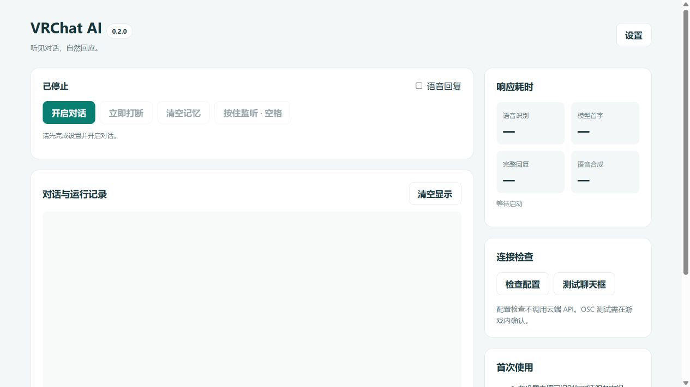

# 0.2.0 验证记录

验证日期：2026-10-16。

## 本地环境

- Windows，64位 CPython 3.13.7。
- 从新建虚拟环境安装 requirements.txt 和 requirements-dev.txt，安装成功。
- PyAudioWPatch 0.2.12.9、NumPy 2.5.4、SciPy 1.18.1、OpenAI SDK 2.54.0、pytest 9.1.1。
- pip check：无依赖冲突。

## 自动化验证

65项测试通过，覆盖：

- 首次运行默认配置、旧配置补全、非法配置拒绝、密钥保留/清除/脱敏、原子写入失败恢复。
- 短噪声后长静音、持续讲话硬上限、保留开头、重采样滤波、手动设备优先、播放期缓冲丢弃、无新音频包时按键释放提交。
- 多语言短句、按顺序断句、长文本分割、完整问答保留。
- 流式 OSC 与 TTS、正在执行的模型/合成结果取消、重置命令、旧代次输入拒绝、实际采样率传递、队列上限与过期、重复启停和启动失败清理。
- 向独立本机 UDP 接收端发送并解析实际 OSC 数据包；未向 VRChat 默认端口发送测试数据。
- 本机 HTTP 会话认证、Host/Origin/跨站校验、密钥脱敏、配置 PATCH、非法 JSON/NaN/超大请求、未启动操作与多客户端有界日志。
- Qwen 的音频 chat/completions 请求结构、内存 WAV 上传、流式 usage-only 分块、超时与 PCM 解码、异常信息脱敏。

运行：

```text
python -m pytest -q
python -m ruff check .
python -m ruff format --check .
python -m compileall -q vrcai bridge.py server.py gui.py
node --check app.js
python -m pip check
```

工作流覆盖 Windows/Ubuntu、Python 3.11/3.13；云端运行结果见仓库 Actions 和 PR 检查。

## 浏览器操作

使用独立的临时配置启动本机服务，完成以下真实页面操作：

1. 初始控制台、运行状态、禁用按钮和中文布局正常显示。
2. 配置检查明确报告 STT/LLM 未配置，未调用任何云端模型。
3. 修改温度为0、自定义 Base URL 和模型后保存成功。
4. 重新打开设置，上述值正确回填，没有恢复默认值。
5. 缺少密钥时点击开启，明确阻止启动并显示缺失项。



## 尚需真实环境联调

- 未使用用户密钥执行任何付费请求。
- 未录制用户的实际系统音频或麦克风。
- 未运行 VRChat 验证聊天框显示、实际音频路由或虚拟麦克风。
- 未下载/加载可选 FunASR 模型。

自动化测试使用替代服务和模拟音频，验证了代码的请求结构、资源释放及控制行为；它们不能替代真实服务账户权限、驱动和游戏环境验证。
